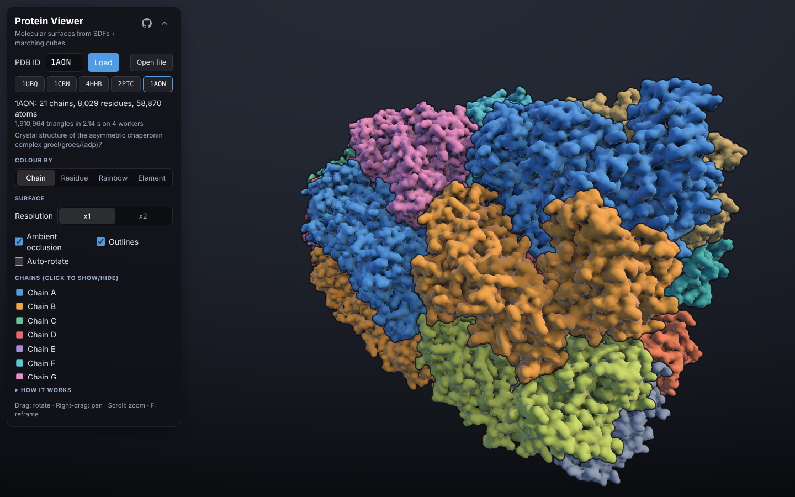
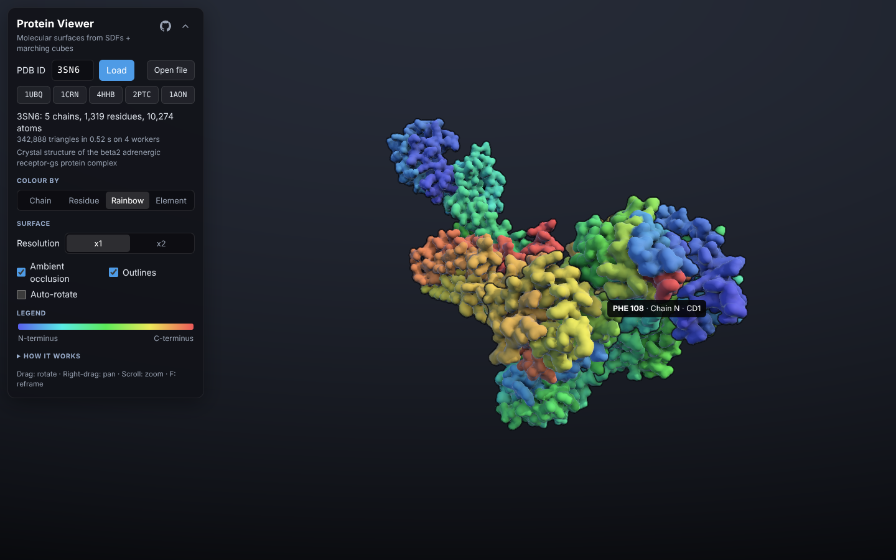
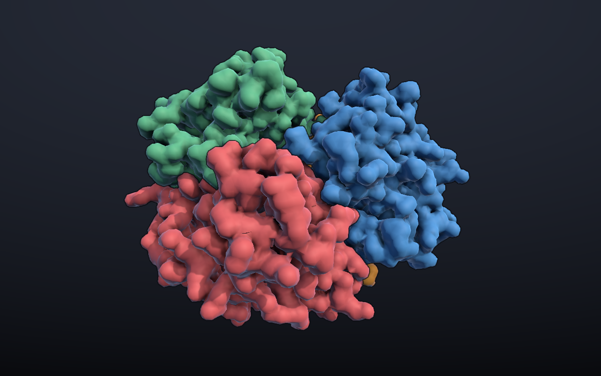

# MolecularSurfaces

Load any protein from the RCSB Protein Data Bank and see its molecular surface in 3D. The surface is built from scratch with signed distance fields and parallel marching cubes, then rendered with screen-space ambient occlusion and per-chain outlines.

**[Open the live viewer](https://meatiewheaties.github.io/MolecularSurfaces/)**. It runs in any modern browser, including on phones. Try [hemoglobin](https://meatiewheaties.github.io/MolecularSurfaces/#4HHB) or the [GroEL–GroES chaperonin](https://meatiewheaties.github.io/MolecularSurfaces/#1AON) (21 chains, 58,000 atoms).



The project started as a Unity (C#) toolkit. The web viewer in [`web/`](web) is a TypeScript and three.js port of the same pipeline, so it runs in a browser with nothing to install. The original Unity project is still in this repository ([below](#unity-version)).

## Features

- **Any PDB entry.** Type a 4-character ID or pick an example. You can also open or drag in a local `.pdb` file. Links such as `…/#4HHB` open that entry directly.
- **Colour by** chain, residue property (hydrophobic, polar, positive, negative, ligand), rainbow from N- to C-terminus, or element. Click chains in the legend to show or hide them.
- **Hover picking.** The residue under the cursor is highlighted and named, with its number, chain and atom.
- **Surface resolution** x1 (1 Å lattice) or x2 (0.5 Å, smoother, about 4× the work).
- **Ambient occlusion, outlines and auto-rotate** toggles. Drag to rotate, right-drag to pan, scroll to zoom, **F** to reframe. On touch screens, drag with one finger and pinch with two.



## How it works

1. **Parse.** [`pdb.ts`](web/src/molecules/pdb.ts) reads the fixed-column PDB format into atoms, residues and chains. It keeps the first model of NMR ensembles and the first alternate location of each atom. Van der Waals radii and residue categories come from [`elements.ts`](web/src/molecules/elements.ts) and [`residues.ts`](web/src/molecules/residues.ts).
2. **Plan.** [`plan.ts`](web/src/surface/plan.ts) builds one surface per chain and leaves out waters. Each chain's atoms are placed on a lattice (1 Å at x1, 0.5 Å at x2), and the lattice is cut into chunks of 32³ cells.
3. **Sample the SDF.** [`chunk.ts`](web/src/surface/chunk.ts) evaluates the union of atom spheres, `min(|p − c| − r)`, at every sample of the chunk, using a spatial hash to find the atoms that reach it. Distances are taken in global lattice coordinates, so neighbouring chunks agree bit for bit on their shared samples and the seams close exactly.
4. **Triangulate.** [`marchingCubes.ts`](web/src/geometry/marchingCubes.ts) runs marching cubes with the lookup tables from the Unity project. An edge cache shares each vertex between the cells that meet there, so the result is an indexed mesh. That gives about 6× fewer vertices than the triangle soup the Unity version produced.
5. **Shade.** [`atomGrid.ts`](web/src/geometry/atomGrid.ts) gives each vertex the atom whose surface is nearest, which drives colouring and picking. It also gives each vertex a smooth normal: the gradients of nearby spheres, weighted by `exp(−3·d)`, so shading blends across the creases where spheres meet.
6. **Run in parallel.** [`builder.ts`](web/src/surface/builder.ts) farms chunks out to a pool of Web Workers ([`worker.ts`](web/src/surface/worker.ts)). Results come back as transferable buffers. Each worker keeps a queue, so the main thread can keep rendering while the build runs. Starting a new load cancels the old build, and workers skip its queued chunks. GroEL–GroES (1.9 million triangles) builds in about a second on four workers.
7. **Render.** [`surfaceView.ts`](web/src/rendering/surfaceView.ts) makes one mesh per chain with a physically based material. The material adds a rim term and highlights the hovered residue through a per-vertex residue attribute and a uniform, so hovering never re-uploads geometry. [`effects.ts`](web/src/rendering/effects.ts) renders a chain-ID pass (which also supplies depth), then normal-oriented SSAO, a depth-aware separable blur, and a composite that adds outlines wherever the chain ID changes. [`lightRig.ts`](web/src/rendering/lightRig.ts) keeps the key and fill lights fixed relative to the camera, and [`orbitCamera.ts`](web/src/rendering/orbitCamera.ts) eases the camera towards its goal pose. Frames are only rendered when something changes.

Add `?debug=ao` or `?debug=ids` to the URL to see the ambient-occlusion or chain-ID buffer.

### Changes from the Unity version

- PDB coordinates are right-handed. Unity's left-handed space showed every structure mirrored; the web viewer shows their true handedness.
- Meshes are indexed rather than triangle soups.
- Atom names in the fixed columns are read in full (`HD21`, not `D21`), and the element is inferred from the atom name when the element columns are blank.
- New in the web version: local files, drag and drop, shareable links, touch controls and a layout for phones.

## Running the web viewer locally

Requires Node.js 22.12 or newer.

```sh
cd web
npm install
npm run dev      # dev server at http://localhost:5173
npm test         # unit tests (parser, marching cubes, chunk seams)
npm run build    # type-check and build the static site into web/dist
```

The build is a static site with relative paths, so `web/dist` can be hosted anywhere.

### Deployment

[`.github/workflows/deploy-web.yml`](.github/workflows/deploy-web.yml) runs the tests, builds the site and deploys it to GitHub Pages on every push to `main` that touches `web/`. Pull requests are tested and built but not deployed. Before the first deploy, enable Pages once: **Settings → Pages → Build and deployment → Source: GitHub Actions**.

## Unity version

The original implementation is a Unity 2022.3 toolkit, written in C#. It has the same pipeline plus a more general SDF modeller.



- **SDF modeling with CSG.** `SDFModel` keeps an ordered stack of box and sphere brushes and combines them with stamp, clip, fill and replace operations. The result is sampled into a voxel grid.
- **Chunked, parallel marching cubes.** `IsoSurface` splits the field into power-of-two chunks (2 to 64 cells per side). It classifies cells and generates triangles in two `Parallel.For` passes, using prefix offsets so each thread writes into its own part of the vertex buffer. Triangulation touches no Unity objects, so whole surfaces are built on a worker thread.
- **Smooth, coloured molecular surfaces.** `SurfaceBuilder` builds one surface per chain. A spatial hash over the atoms assigns each vertex its nearest atom, which drives colouring, hover picking and highlighting. It also gives each vertex a smooth normal, blended from the gradients of nearby atom spheres. Resolution can be set to x1 or x2.
- **Screen-space effects in the built-in pipeline.** `SurfaceEffects` adds normal-oriented SSAO with a depth-aware blur, and outlines wherever the chain changes. Chain IDs come from a replacement-shader pass. It also draws a gradient background. `CameraLightRig` keeps key and fill lights fixed relative to the camera.
- **Spatial bounds and raycasting.** `BoundsBox`, `BoundsSphere`, `BoundsGrid` and `BoundsSpace` all implement a shared `IBounds` interface. `Raycasting` provides ray/bounds intersection.
- **PDB parsing and molecular model.** `ProteinBuilder` parses PDB text into chains, residues and atoms. It uses the first model of NMR entries. It comes with element and residue property tables and selection queries by residue type or sequence pattern.

### Running the Unity viewer

1. Open the project in Unity 2022.3.23f1. If Unity asks, import the TextMeshPro Essential Resources.
2. Open `Assets/Scenes/Protein Viewer.unity` and press Play. Ubiquitin (`1UBQ`) loads first.
3. Type any 4-character PDB ID into the panel and press **Enter** or **Load**, or click one of the example buttons. The structure is downloaded and its surface is built on background threads, with a progress bar. The camera then eases to frame it.

The panel offers the same colour schemes, chain toggles, resolution and effect toggles as the web viewer. An internet connection is required. Very large entries that RCSB only publishes as mmCIF can't be loaded by either version.

## Layout

```
web/                    browser viewer (TypeScript, three.js, Vite)
  src/
    molecules/          PDB parser, element and residue tables
    geometry/           marching cubes, lookup tables, atom spatial hash
    surface/            chunk planning, SDF sampling, worker pool
    rendering/          surface meshes, colour schemes, SSAO/outline effects, lights, camera
    main.ts             UI and loading
  test/                 Vitest unit tests
Assets/                 Unity project
  Scripts/
    Geometry/           bounds, raycasting, marching cubes, SDF model and brushes
    Molecules/          atom / residue / protein model, PDB builder, queries
    Rendering/          surface builder, colour schemes, surface view, SSAO/outline effect, light rig
    DataSources/        RCSB download, local PDB cache, CSV reader
    Components/         MonoBehaviour instances for the SDF and mesh types
    Presentation/       slide and on-screen text helpers
    Demos/              ProteinViewer (UI + loading), OrbitCamera
  Resources/Shaders/    surface, chain-ID and screen-effect shaders
  Scenes/
    Protein Viewer.unity
```
