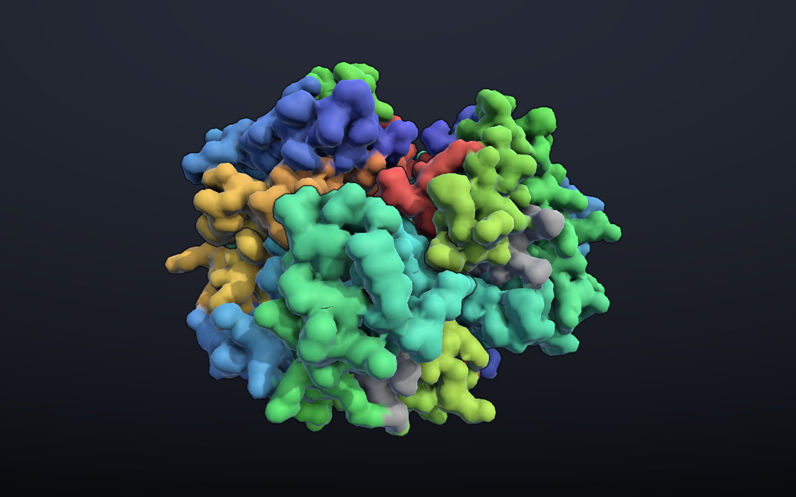

# MolecularSurfaces

A Unity (2022.3) toolkit for loading protein structures from the RCSB Protein Data Bank and turning them into meshes, using signed distance fields and a parallel marching-cubes mesher. It includes an interactive viewer with colour schemes, screen-space ambient occlusion and per-chain outlines.


## Highlights

- **SDF modeling with CSG.** `SDFModel` keeps an ordered stack of box and sphere brushes and combines them with stamp, clip, fill and replace operations. The result is sampled into a voxel grid.
- **Chunked, parallel marching cubes.** `IsoSurface` splits the field into power-of-two chunks (2 to 64 cells per side). It classifies cells and generates triangles in two `Parallel.For` passes, using prefix offsets so each thread writes into its own part of the vertex buffer. Triangulation touches no Unity objects, so whole surfaces are built on a worker thread.
- **Smooth, coloured molecular surfaces.** `SurfaceBuilder` builds one surface per chain. A spatial hash over the atoms assigns each vertex its nearest atom, which drives colouring, hover picking and highlighting. It also gives each vertex a smooth normal, blended from the gradients of nearby atom spheres. Resolution can be set to x1 or x2.
- **Screen-space effects in the built-in pipeline.** `SurfaceEffects` adds normal-oriented SSAO with a depth-aware blur, and outlines wherever the chain changes. Chain IDs come from a replacement-shader pass. It also draws a gradient background. `CameraLightRig` keeps key and fill lights fixed relative to the camera.
- **Spatial bounds and raycasting.** `BoundsBox`, `BoundsSphere`, `BoundsGrid` and `BoundsSpace` all implement a shared `IBounds` interface. `Raycasting` provides ray/bounds intersection.
- **PDB parsing and molecular model.** `ProteinBuilder` parses PDB text into chains, residues and atoms. It uses the first model of NMR entries. It comes with element and residue property tables and selection queries by residue type or sequence pattern.



## Layout

```
Assets/
  Scripts/
    Geometry/      bounds, raycasting, marching cubes, SDF model and brushes
    Molecules/     atom / residue / protein model, PDB builder, queries
    Rendering/     surface builder, colour schemes, surface view, SSAO/outline effect, light rig
    DataSources/   RCSB download, local PDB cache, CSV reader
    Components/    MonoBehaviour instances for the SDF and mesh types
    Presentation/  slide and on-screen text helpers
    Demos/         ProteinViewer (UI + loading), OrbitCamera
  Resources/Shaders/  surface, chain-ID and screen-effect shaders
  Scenes/
    Protein Viewer.unity
```

## Running the viewer

1. Open the project in Unity 2022.3.23f1. If Unity asks, import the TextMeshPro Essential Resources.
2. Open `Assets/Scenes/Protein Viewer.unity` and press Play. Ubiquitin (`1UBQ`) loads first.
3. Type any 4-character PDB ID into the panel and press **Enter** or **Load**, or click one of the example buttons. The structure is downloaded and its surface is built on background threads, with a progress bar. The camera then eases to frame it.

From the panel you can:

- **Colour by** chain, residue property (hydrophobic, polar, positive, negative, ligand), rainbow from N- to C-terminus, or element.
- **Show or hide chains** from the legend when colouring by chain.
- Switch **resolution** between x1 and x2. x2 is smoother but takes about four times as long to build.
- Toggle **ambient occlusion**, **outlines** and **auto-rotate**.

Hover over the surface to highlight a residue and see its name, number, chain and atom.

Controls: left-drag to rotate, right- or middle-drag to pan, scroll to zoom, and **F** to reframe.

An internet connection is required. Waters are left out of the surface. Very large entries that RCSB only publishes as mmCIF can't be loaded.
